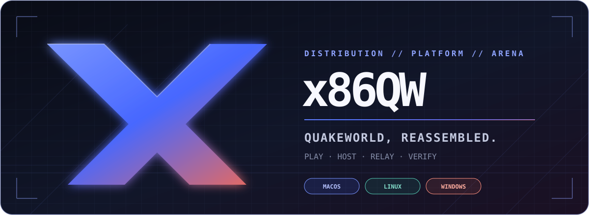
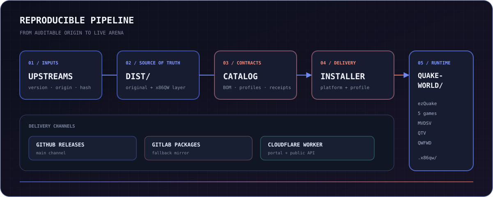

<div align="center">
  <picture>
    <source media="(prefers-color-scheme: dark)" srcset=".github/assets/hero-dark.svg">
    <source media="(prefers-color-scheme: light)" srcset=".github/assets/hero-light.svg">
    
  </picture>

  <br>

  **Uma distribuição moderna, reproduzível e autocontida de QuakeWorld.**<br>
  Cliente, jogos, servidor dedicado, relay e proxy — instalados por uma única CLI verificável.

  [](https://github.com/x86dx2/x86qw/releases/latest)
  [](https://github.com/x86dx2/x86qw/actions/workflows/validate.yml)
  [](https://qw.x86.com.br/)
  [](#compatibilidade)

  [**Instalar**](#instalação) · [Explorar](#o-que-vem-no-x86qw) · [Operar](#uma-cli-toda-a-arena) · [Arquitetura](#arquitetura) · [Contribuir](#contribuindo)
</div>

---

## QuakeWorld sem arqueologia

O x86QW transforma um ecossistema histórico em um produto atual: seleciona versões conhecidas, preserva as origens, aplica customizações isoladas e entrega tudo por um catálogo com tamanho e SHA-256. O resultado é uma instalação organizada, atualizável e capaz de jogar localmente, entrar em servidores ou subir sua própria infraestrutura.

<table>
  <tr>
    <td width="33%" valign="top"><h3>⚡ Entre na partida</h3>ezQuake stable ou nightly, conteúdo curado do nQuake e cinco jogos prontos para a mesma instalação.</td>
    <td width="33%" valign="top"><h3>🧩 Monte seu perfil</h3>Escolha entre os perfis essencial, recomendado, completo ou uma seleção personalizada de componentes.</td>
    <td width="33%" valign="top"><h3>🛡️ Verifique os bytes</h3>Pacotes imutáveis, hashes registrados, recibos locais e reparo explícito sem confundir arquivos pessoais com payload gerenciado.</td>
  </tr>
  <tr>
    <td width="33%" valign="top"><h3>🎯 Domine o KTX</h3>Duel, equipes, CTF, Race, Clan Arena, Wipeout, Frogbots e dezenas de combinações declarativas.</td>
    <td width="33%" valign="top"><h3>📡 Hospede a arena</h3>MVDSV, QTV e QWFWD independentes, em primeiro plano e restritos a loopback até você pedir exposição de rede.</td>
    <td width="33%" valign="top"><h3>♻️ Atualize com controle</h3>Veja o plano antes da mudança, confirme interativamente e use <code>--dry-run</code> em automações e auditorias.</td>
  </tr>
</table>

## Instalação

> [!IMPORTANT]
> O x86QW organiza e distribui software e conteúdo de diferentes origens. Leia [Proveniência e licenças](#proveniência-e-licenças) antes de redistribuir o conjunto.

### macOS e Linux

```sh
curl -fsS https://qw.x86.com.br/install.sh | bash
```

O instalador publica o comando `x86qw` em `~/.local/bin`. Se esse diretório
ainda não estiver no `PATH`, a etapa final mostra o caminho exato que deve ser
adicionado ao shell.

### Windows

No PowerShell ou no Prompt de Comando:

```powershell
powershell -c "irm https://qw.x86.com.br/install.ps1 | iex"
```

No Windows, a instalação cria atalhos do x86QW no Menu Iniciar e na Área de
Trabalho com o ícone oficial do projeto.

O bootstrap baixa a CLI nativa `x86qw` da release `x86qw-cli-2.3.2` no
GitHub, confere tamanho e SHA-256 fixados no próprio script e executa
`x86qw setup`, que consulta o catálogo TUF público e pergunta onde instalar.
Nada além do sistema é necessário: macOS e Linux usam `curl`, e o Windows usa
o PowerShell incluído. O bootstrap não encerra a sessão atual do PowerShell; se
a instalação falhar, a mensagem e o código ficam visíveis em `$LASTEXITCODE`.

O comando Windows recusa scripts acima de 256 KiB antes de executá-los, via
buffer limitado do `HttpClient`, sem `irm | iex` ilimitado. No Unix, o corpo do
bootstrap só corre na última linha `x86qw_install_main "$@"`; um download
truncado falha na análise e não executa nada.

A audiência continua `owner-only`. Isso não é autorização `external-public`
nem promessa de suporte para usuários externos. O sistema atual é detectado
automaticamente. Para preparar outra plataforma a partir de macOS ou Linux:

```sh
curl -fsS https://qw.x86.com.br/install.sh | bash -s -- --platform windows
```

Os valores aceitos são `macos`, `linux` e `windows`. Os binários da CLI também
estão na [release `x86qw-cli-2.3.2`](https://github.com/x86dx2/x86qw/releases/tag/x86qw-cli-2.3.2),
com `SHA256SUMS`.

Na árvore de desenvolvimento, artefatos promovidos à instalação também exigem
tamanho e SHA-256 exatos, limite máximo e deadline total. Metadados dinâmicos
possuem limites próprios, mas nunca são promovidos como payload. Um candidato
upstream novo precisa ter tamanho e SHA-256 revisados e corresponder a uma
autoridade declarada de release, upstream, pacote ou referência nQuake antes do
download persistente. URLs armazenadas em catálogo, manifesto e inventários
passam pela mesma política HTTPS e não aceitam credenciais, fragmentos, queries,
espaços ou controles. Sua autenticação versionada pertence a uma etapa
posterior. A CLI current é a `2.3.2`, nativa em Go; os instaladores Python
`0.x` e `1.0.x` permanecem históricos e imutáveis nos mirrors. Nenhum conteúdo
desta árvore muda os bytes já publicados.

## O que vem no x86QW

### Cinco jogos, uma instalação

| Jogo | Versão | Experiência |
|---|:---:|---|
| **KTX** | 1.47 | Competitivo, equipes, CTF, Race e Frogbots |
| **Final Arena** | 1.20 | Arsenal e regras próprias em arenas QuakeWorld |
| **Pro-X** | 1.1 | Conversão completa preservada e harmonizada |
| **Team Fortress** | 2.9 | Classes, equipes e objetivos clássicos |
| **Total Destruction 2** | 2.22 | Gameplay expandido com customização x86QW isolada |

### Perfis para cada tipo de instalação

| Perfil | Conteúdo | Ideal para |
|---|---|---|
| **Essencial** | Base visual + KTX | Entrar rápido e jogar QuakeWorld competitivo |
| **Recomendado** | Essencial + mapas, skins, modelos, texturas e documentação | A experiência x86QW equilibrada |
| **Completo** | Todos os 21 componentes, cinco jogos, MVDSV, QTV e QWFWD | Jogadores, hosts e exploradores do ecossistema |
| **Personalizado** | Seleção explícita de componentes | Instalações mínimas ou especializadas |

<details>
<summary><strong>Modos KTX e opções avançadas</strong></summary>

O catálogo cobre 17 usermodes nativos: Duel, 2on2, 3on3, 4on4, 10on10, FFA, CTF, HoonyMode, Blitz 2v2/4v4, 2on2on2, 3on3on3, 4on4on4, XonX, Wipeout, Clan Arena e ThunderWalker ToT. `3on3` identifica duas equipes de três jogadores; `2on2on2`, três equipes de dois. Os aliases `3v3` e `2v2v2` continuam aceitos pela CLI. Também inclui Midair, DMM4, Instagib, LGC, Rocket Arena, Race e Practice.

```sh
./x86qw.sh play ktx --mode duel --map dm6 --bots 1 --bot-skill 8 --bot-names x86qw
./x86qw.sh play ktx --mode ffa --map dm6 --bots 4 --bot-skill random
./x86qw.sh play ktx --mode ctf --ctf-hook smooth --ctf-runes off
./x86qw.sh play ktx --mode race --map slide1 --race-style match --race-scoring formula1
```

`--help` detalha Frogbots, regras de CTF e formatos de Race. O launcher valida mapas, combinações e limitações do QVM antes de iniciar o cliente. Com bots, o menu mostra somente BSPs com rota Frogbot; CTF e Race cruzam os mapas instalados com seus ENTs e rotas. Rotas pessoais regulares também são reconhecidas.
No navegador interativo, essas opções aparecem somente quando fazem sentido:
os 24 modos são primeiro agrupados em recomendados, individuais, equipes,
arena/alternativos e treino, com uma entrada adicional para consultar o catálogo
completo. Nenhum modo é ocultado por essa organização.
Race pergunta formato, pontuação, pacemaker e visibilidade dos corredores; CTF
pergunta gancho, runas e spawn; modos compatíveis oferecem Frogbots, habilidade
e nomes. Há quatro perfis: `KTX Default`, nomes originais sem customização e seleção
inicial do menu; `x86QW aleatório`, mapas e modos da distribuição embaralhados
a cada lançamento; `One Piece (opcional)`, a lista One Piece embaralhada; e
uma lista pessoal editável. Veja o
[guia de nomes dos Frogbots](docs/FROGBOTS.md).
Modos de tamanho fixo limitam a seleção às vagas restantes: Duel oferece no
máximo um bot quando há um jogador humano.
Ao entrar no mapa, o console imprime as teclas do modo ativo. Em Duel, `F5`
marca ready, `F6` interrompe e `F11` mostra as regras; com Frogbots, `INS`,
`DEL`, `HOME` e `END` gerenciam bots e habilidade. Os perfis nomeados também
preservam as cores de camisa, calça e equipe definidas pelo KTX.
`--bot-skill random` sorteia uma habilidade independente de 1 a 20 sempre que
um bot entra. `INS` respeita a lotação do modo, `DEL` libera a vaga e
`HOME`/`END` alteram cumulativamente a habilidade dos próximos bots. Arma, vida
e interrupção por morte são opções exclusivas do ToT. `F12` fecha diretamente
o QuakeWorld em todos os cinco jogos.

</details>

## Uma CLI, toda a arena

Depois da instalação, `x86qw.sh` — ou `x86qw.cmd` no Windows — é o ponto único de entrada.
Sem argumentos, ele abre um navegador por tarefas: **Jogar**, **Encontrar
servidor**, **Hospedar**, **Serviços** e **Gerenciar instalação**.
Cada item mostra seu número equivalente. Use `↑`/`↓` ou `j`/`k`, avance com
`→`/Enter, volte exatamente uma etapa com `←`, use Esc para sair e pressione
`/` para buscar em listas longas. Atalhos com dois dígitos são confirmados com
Enter; listas maiores mostram a faixa visível e o total. Opções indisponíveis
continuam visíveis com o motivo. Em terminais estreitos, descrições e legendas
são quebradas sem perder contexto. Em terminais sem navegação interativa, o
mesmo fluxo usa opções numeradas.

Antes de abrir o ezQuake, **Jogar** apresenta jogo, modo, mapa, cliente, bots e o
comando equivalente. **Encontrar servidor** revisa servidor, ação e cliente;
QTV e QWFWD isolados também exibem endpoint, upstream e comando seguro antes da
confirmação. **Hospedar** escolhe jogo, regras e mapa antes da
infraestrutura; em seguida oferece **Rápido local** — loopback, MVD ativo e sem
serviços adicionais — ou **Avançado**, com rede, portas, QTV, QWFWD e senhas.
Esses fluxos exigem confirmação final e ainda não adquiriram lock nem iniciaram
processos quando o resumo é exibido. Toda ação concluída ou falha permanece
visível até Enter antes de o menu ser redesenhado. Segredos nunca aparecem no
comando equivalente. As flags abaixo continuam sendo o contrato estável para
automação e acesso direto.

Nos resumos, o comando equivalente usa `./x86qw.sh` em Unix e `x86qw.cmd` no
Windows. Hosts e serviços podem permanecer no terminal ou usar `--background`;
em segundo plano, o menu **Serviços** mostra controlador, processos, endpoints,
parâmetros e log, e oferece encerramento coordenado da stack.

```text
JOGAR                         OPERAR                         MANTER
x86qw play                    x86qw host                    x86qw update
x86qw play ktx --mode ctf     x86qw proxy                   x86qw upgrade
x86qw hub                     x86qw qtv                     x86qw verify
                              x86qw status                  x86qw doctor
                              x86qw profile                 x86qw ui
                              x86qw library                 x86qw repair
```

| Comando | Faz o quê |
|---|---|
| `play` | Abre um dos jogos instalados no ezQuake |
| `host` | Inicia um servidor dedicado MVDSV; `--save-preset` / `--preset` layouts locais sem senhas |
| `proxy` | Executa o proxy de rota QWFWD |
| `qtv` | Inicia o relay/espectador QTV |
| `status` | Mostra a stack ativa; `--stop` solicita encerramento coordenado |
| `hub` | Lista servidores públicos; se o Hub falhar, usa favoritos/recentes locais |
| `update` | Atualiza a CLI e o que já está instalado |
| `upgrade` | Também incorpora novidades do perfil escolhido |
| `verify` | Compara a instalação com os recibos registrados |
| `doctor` | Diagnostica a instalação sem alterar arquivos; `--bundle` gera um zip sanitizado |
| `ui` | Painel HTML local somente leitura sobre doctor e library |
| `profile` | Mostra a fronteira perfil/cache/pessoal; `--backup` / `--restore` as configs user-owned |
| `library` | Favoritos e recentes locais com origem e freshness; `--add` / `--remove` |
| `changes` | Mostra arquivos novos, alterados ou removidos localmente |
| `migrate` | Converte metadados legados para o contrato 1.0 |
| `repair` | Recompõe somente conteúdo gerenciado ausente ou incorreto |
| `cleanup` | Remove resíduos seguros identificados pela CLI |
| `uninstall` | Desinstala com confirmação explícita |
| `version` | Mostra a versão da CLI instalada |

`migrate --dry-run` somente exibe a conversão dos metadados antigos para o
layout 1.0. `migrate` executa a conversão em uma transação; ele não baixa
pacotes nem altera PAKs, configurações pessoais, demos ou logs.

### Hosting seguro por padrão

```sh
./x86qw.sh host ktx --mode 4on4 --map dm3
./x86qw.sh host team-fortress --map 2fort5r
./x86qw.sh host td2 --map dm6 --bind 0.0.0.0 --with-qtv
./x86qw.sh proxy --bind 0.0.0.0
./x86qw.sh qtv --upstream 127.0.0.1:28501
./x86qw.sh status
```

Serviços usam loopback por padrão e só são expostos com `--bind` explícito. Senhas podem vir de prompt oculto ou arquivo privado; a CLI evita colocá-las no comando filho e na saída. Locks e journals impedem manutenção concorrente, coordenam o encerramento e permitem recuperação conservadora após crash. Veja o [guia de hosting](docs/HOSTING.md).

A CLI inspeciona ZIP e PK3 antes de qualquer extração, com limites, modos
canônicos e promoção atômica. No Windows, o estado privado da instalação nasce
com DACL protegida, limitada ao usuário atual e a `LOCAL SYSTEM`; arquivos de
senha externos só são aceitos com essa mesma restrição e nunca são reescritos.
Consulte os [ADR 0002](docs/adr/0002-fronteira-unica-de-arquivos.md) e
[ADR 0003](docs/adr/0003-dacl-privada-windows.md).

## Arquitetura

<a href="docs/diagrams/x86qw-platform.html">
  <picture>
    <source media="(prefers-color-scheme: dark)" srcset=".github/assets/architecture-dark.svg">
    <source media="(prefers-color-scheme: light)" srcset=".github/assets/architecture-light.svg">
    
  </picture>
</a>

O repositório é a fonte canônica. `dist/` preserva os inputs; inventários declaram consumidores e dependências; o catálogo projeta pacotes públicos; o instalador materializa apenas o perfil e a plataforma escolhidos. GitHub Releases é o canal principal de artefatos e GitLab Generic Packages mantém o mirror de contingência.

Todo o código vive em `go/`: a CLI `x86qw` (instalação, jogo, hub, serviços e
manutenção da instalação), `x86qw-content` (verificação, atualização, build e
publicação do `dist/`) e `x86qw-release` (bootstraps, catálogo da CLI,
assinatura TUF, montagem do site e monitor). O repositório não contém Python.

Mutações duráveis de instalação, atualização, repair, cleanup e uninstall
retêm inversos até o resultado lógico final. Logs produzidos durante execução
continuam append-only e não são apresentados como transacionais. Os entrypoints
ainda concentram a composição da CLI, mas console, parser e navegação já são
canônicos no runtime. A validação local integral foi concluída; a matriz da PR
e os smokes reais do candidato permanecem separados. Consulte o
[ADR 0005](docs/adr/0005-fronteiras-incrementais-x86qw-runtime.md) e a
[evidência da implementação](docs/implementation/runtime-boundaries-pr6.md).

```text
dist/           produto canônico, upstreams preservados e customizações x86QW
maintenance/    inventários, receitas, validação, build e publicação
site/           portal, API pública do catálogo e deploy Cloudflare
docs/           arquitetura, hosting, decisões e roadmaps
```

[Arquitetura detalhada](docs/architecture.md) · [Diagrama interativo](docs/diagrams/x86qw-platform.html) · [Proveniência](maintenance/docs/provenance.md) · [Roadmap](docs/ROADMAP.md) · [Status](docs/PROJECT-STATUS.md)

## Estado do projeto

A CLI current é `2.3.2` owner-only: um usuário, validada no Apple M3. Os
binários de macOS, Windows e Linux estão no catálogo e na release
`x86qw-cli-2.3.2`; Windows e Linux seguem em preview até a evidência nativa da
fase correspondente.
Soak, migração histórica e audiência `external-public` não bloqueiam
desenvolvimento. Consulte o [status operacional](docs/PROJECT-STATUS.md).

## Compatibilidade

| Componente | macOS | Linux | Windows |
|---|:---:|:---:|:---:|
| ezQuake stable + nightly | Universal · condicional/preview | x86-64 · preview | x64 · preview |
| MVDSV | arm64 · preview | amd64 · preview | x64 · preview |
| QTV | arm64 · preview | amd64 · preview | x64 · preview |
| QWFWD | arm64 · preview | amd64 · preview | x64 · preview |
| CLI `x86qw` | arm64 + amd64 | amd64 + arm64 | x64 |

> [!NOTE]
> A CI obrigatória roda os testes Go em Ubuntu e Windows, compila a CLI para as cinco plataformas e valida distribuição e site. Isso não equivale a smoke nativo fora do Apple M3.

Na release `0.7.2`, o stable macOS preserva o bundle
upstream sem alterar `Info.plist`, sandbox, entitlements ou assinatura. Isso
remove a re-assinatura ad hoc feita pelo x86QW, mas não torna o artefato
Developer ID ou notarizado. Stable e nightly macOS permanecem condicionais até
os smokes nativos do candidato exato. A release pública `0.7.1` continua
imutável; consulte o [ADR 0004](docs/adr/0004-preservar-bundle-upstream-ezquake-stable-macos.md).

## Desenvolvendo

Quem clonou o repositório usa as fontes locais canônicas:

```sh
git lfs pull
go -C go run ./cmd/x86qw --help
go -C go run ./cmd/x86qw play --help
```

A validação integral:

```sh
go -C go test ./...
go -C go run ./cmd/x86qw-content verify
cd site && npm test && npm run deploy:dry-run
```

Para visualizar o portal localmente:

```sh
cd site
npm run dev
```

A configuração versionada de produção não contém um diretório de assets. Um
deploy real só é permitido pelos workflows protegidos, que passam por
`--assets` a geração montada e verificada; executar `wrangler deploy` sem esse
argumento falha fechado.

Abra `http://127.0.0.1:8787`. O fluxo completo de manutenção está em [maintenance/README.md](maintenance/README.md) e a operação do site em [site/README.md](site/README.md).

## Contribuindo

Contribuições são bem-vindas quando preservam proveniência, reprodutibilidade e a fronteira entre upstream e customização x86QW. Antes de abrir um PR:

1. leia o [guia de contribuição](.github/CONTRIBUTING.md);
2. mantenha cada mudança pequena e rastreável;
3. execute `go -C go test ./...` e `go -C go run ./cmd/x86qw-content verify`;
4. explique a origem e o consumidor de qualquer novo arquivo distribuído.

[Reportar um bug](https://github.com/x86dx2/x86qw/issues/new?template=bug-report.yml) · [Propor uma melhoria](https://github.com/x86dx2/x86qw/issues/new?template=feature-request.yml) · [Obter suporte](.github/SUPPORT.md) · [Política de segurança](.github/SECURITY.md)

## Proveniência e licenças

x86QW é uma distribuição composta, não uma relicença única de todos os seus componentes. Clientes, engines, mods, ferramentas e conteúdo mantêm suas licenças e termos de origem; customizações próprias ficam separadas dos bytes upstream. Os dados-base registrados são tratados como componente independente e não fazem parte do bundle enxuto do instalador.

Consulte [proveniência e licenças por componente](maintenance/docs/provenance.md) antes de copiar, publicar ou redistribuir artefatos. QuakeWorld, Quake e marcas relacionadas pertencem aos seus respectivos titulares; este projeto comunitário não é afiliado nem endossado por eles.

---

<div align="center">
  <strong>READY // CONNECT // FRAG</strong><br>
  <sub>Feito para preservar QuakeWorld — e continuar jogando.</sub><br><br>
  <a href="https://qw.x86.com.br/">Portal</a> ·
  <a href="https://github.com/x86dx2/x86qw/releases">Releases</a> ·
  <a href="https://gitlab.com/x86dx2/x86qw">Mirror GitLab</a> ·
  <a href="https://github.com/x86dx2/x86qw/issues">Issues</a>
</div>
